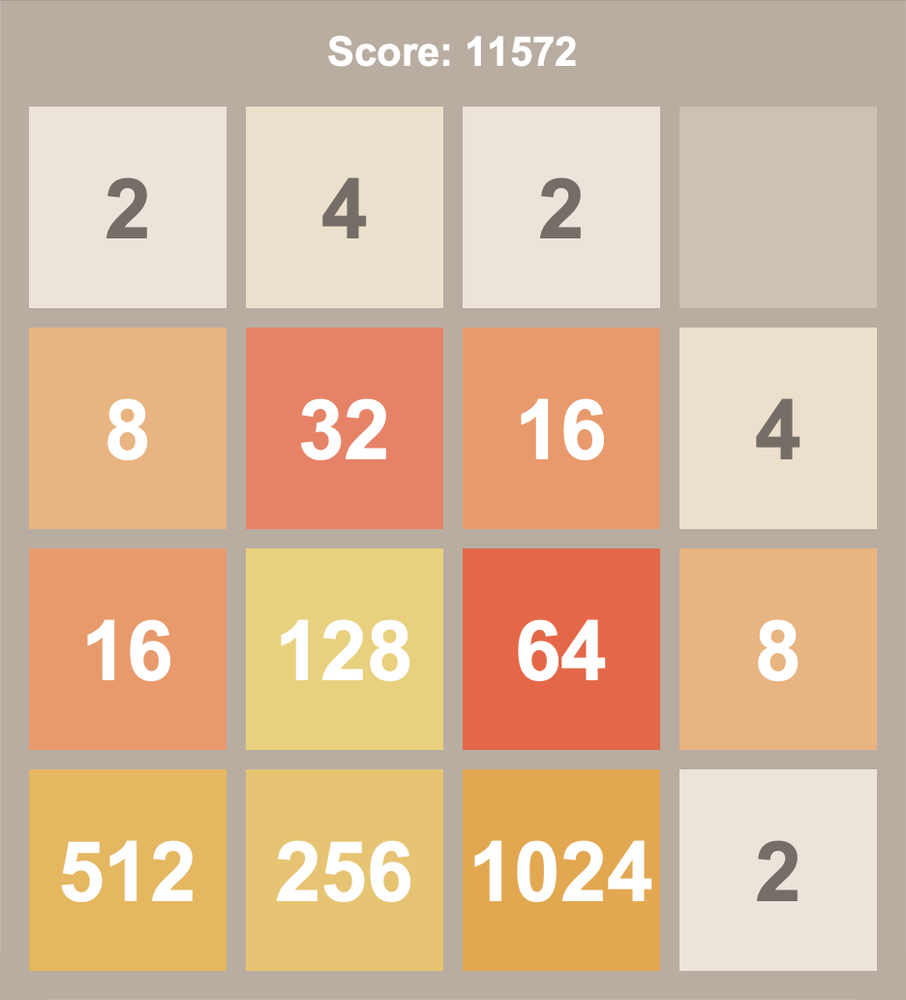
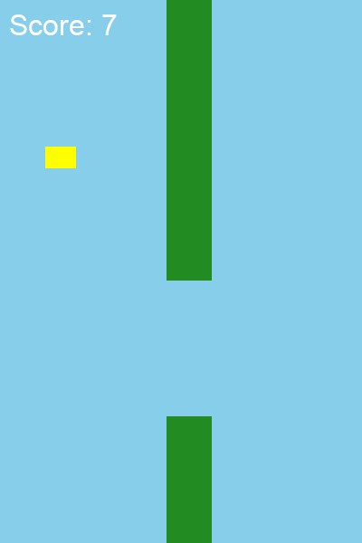
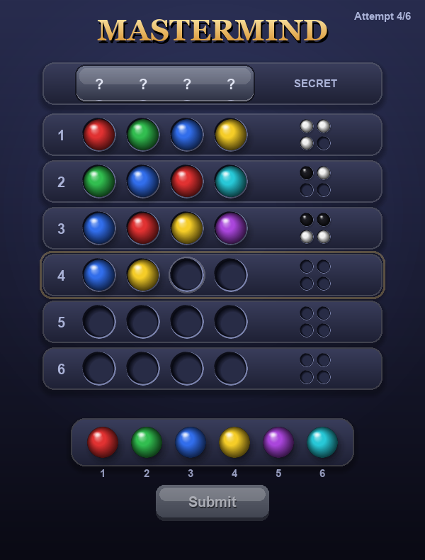
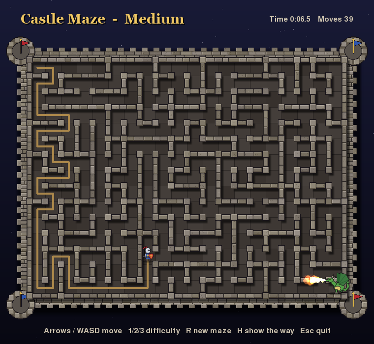
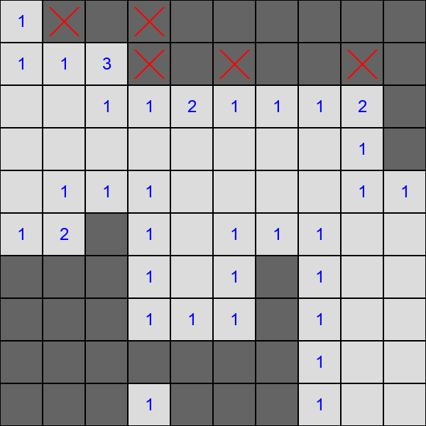
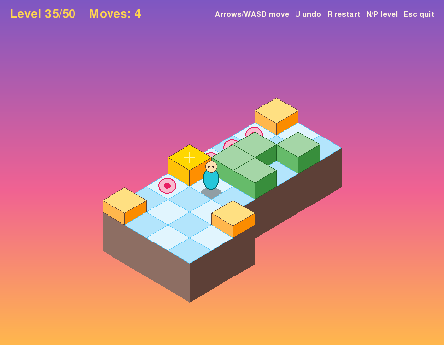
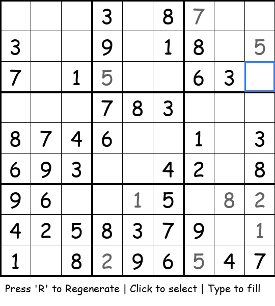
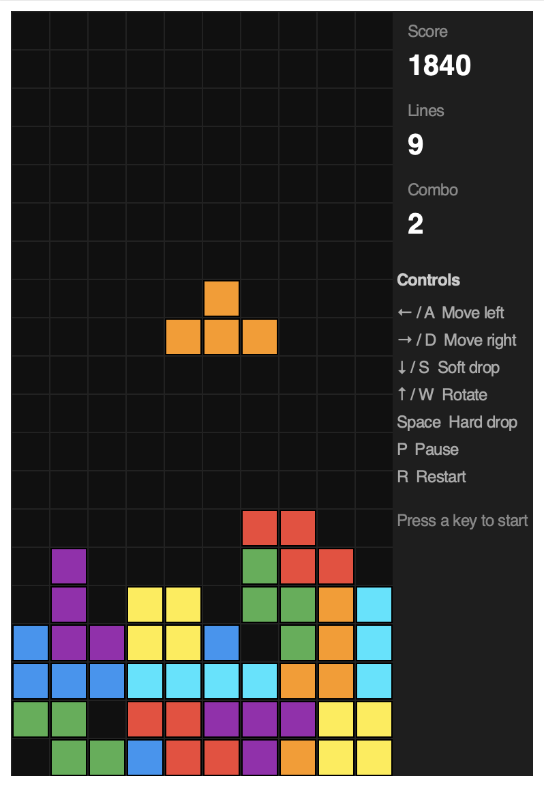

# Retro Games

Eight small retro games in Python, one file each. Five are built with
[pygame-ce](https://pyga.me/); three use Tkinter and need nothing beyond the
standard library.

| Game | File | Toolkit |
| --- | --- | --- |
| [2048](#2048) | `2048_game.py` | Tkinter |
| [Flabby Bird](#flabby-bird) | `flabby_bird.py` | pygame |
| [Mastermind](#mastermind) | `mastermind.py` | pygame |
| [Maze](#maze) | `maze_game.py` | Tkinter |
| [Minesweeper](#minesweeper) | `minesweeper.py` | pygame |
| [Sokoban](#sokoban) | `sokoban.py` | pygame |
| [Sudoku](#sudoku) | `sudoku.py` | pygame |
| [Tetris](#tetris) | `tetris_game.py` | Tkinter |

## Setup

Requires Python 3. The Tkinter games also need a Python build with Tk
(on Homebrew: `brew install python-tk`).

```bash
bash setupenv.sh            # creates .venv and installs requirements.txt
source .venv/bin/activate
python menu.py              # game menu: pick a game and play
python sokoban.py           # or run any game file directly
```

In the menu, choose a game with the **arrow keys** or the mouse and press
**Enter** (or click) to play. Closing the game brings you back to the menu;
**Esc** quits.

## The games

### 2048



Slide the tiles and merge matching numbers to reach 2048.

- **Arrow keys** — slide tiles
- **R** — restart

### Flabby Bird



Keep the bird in the air and thread it through the gaps in the pipes.

- **Space** — flap (and restart after a crash)

### Mastermind



Crack the secret code of 4 colours in 6 attempts. After each guess a black peg
means right colour in the right position, a white peg means right colour in
the wrong position.

- **Click a colour** or **1–6** — place a peg
- **Click a placed peg** / **Backspace** — remove a peg
- **Enter** or the **Submit** button — submit the guess
- **R** — new game (once the round is over)
- **Esc** — quit

### Maze



Find your way from the top-left corner to the exit. Every maze is randomly
generated.

- **Arrow keys** / **WASD** — move
- **R** / **Enter** — new maze

### Minesweeper



A 10×10 board hiding 15 mines.

- **Left click** — reveal a cell
- **Right click** — flag / unflag a cell
- **R** — restart

### Sokoban



Push every box onto a goal, in isometric view. The 50 levels are read from
`sokoban_levels.h`, which must sit next to `sokoban.py`.

- **Arrow keys** / **WASD** — move
- **U** / **Z** — undo
- **R** — restart the level
- **N** / **P** — next / previous level
- **Esc** — quit

### Sudoku



A freshly generated puzzle every time. Your own entries are shown in grey.

- **Click** — select a cell
- **1–9** — fill the selected cell
- **Backspace** / **Delete** — clear it
- **R** — generate a new puzzle

### Tetris



Classic falling blocks, with a score multiplier for clearing lines with
consecutive pieces.

- **←** / **→** or **A** / **D** — move
- **↑** / **W** — rotate
- **↓** / **S** — soft drop
- **Space** — hard drop
- **P** — pause
- **R** — restart (after game over)
