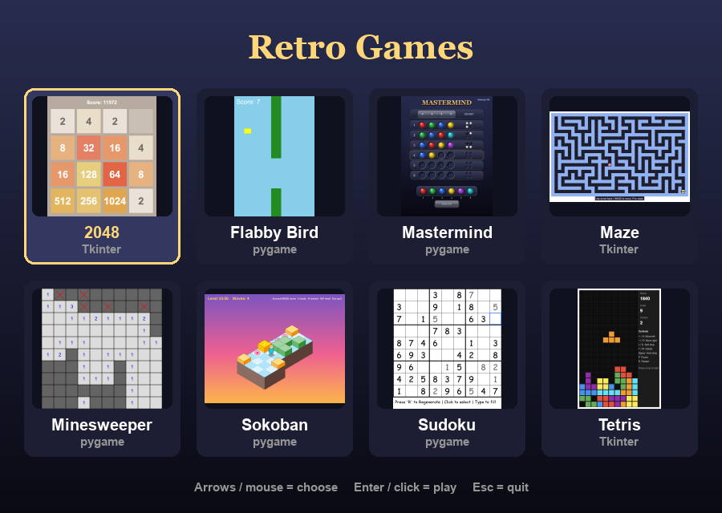
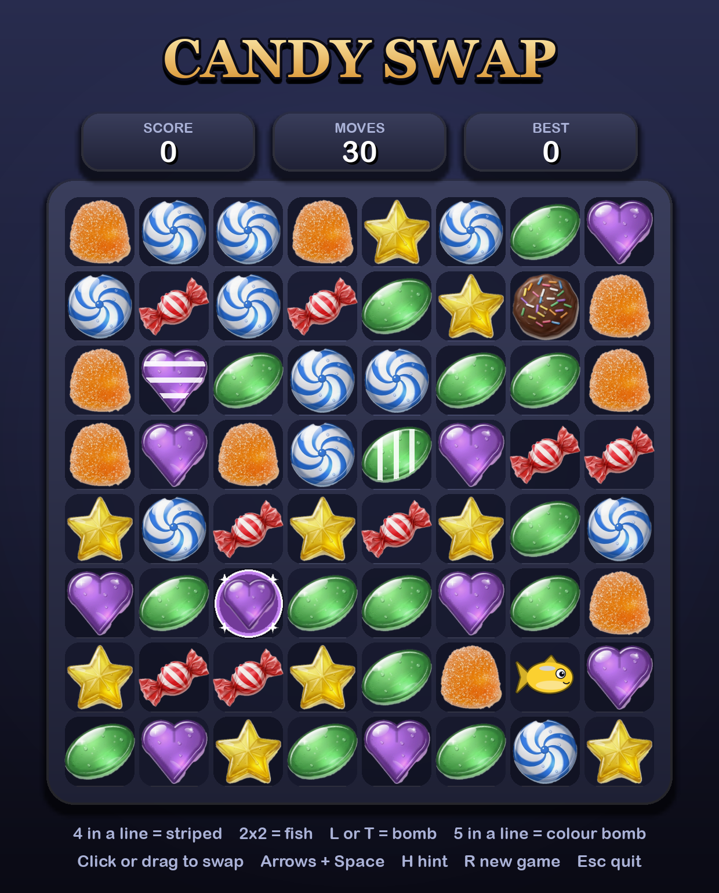
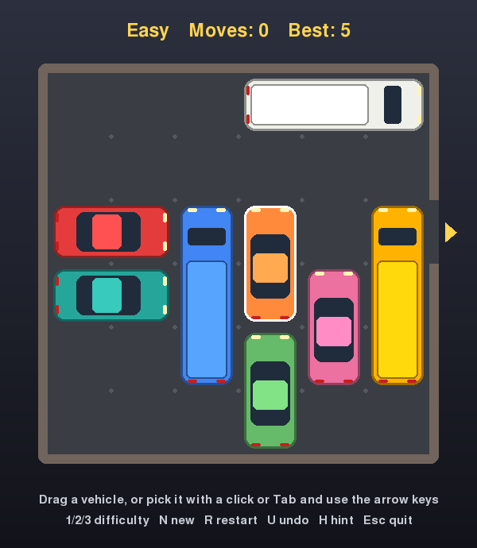
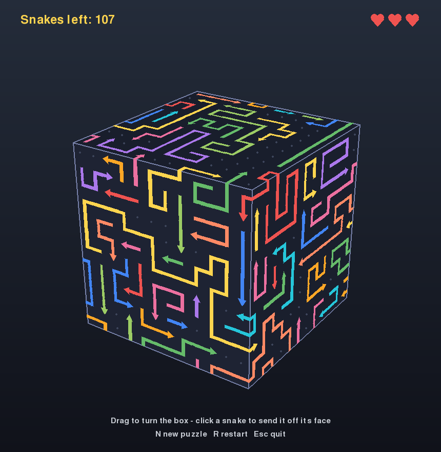

# Retro Games

Ten small retro games in Python, one file each. Eight are built with
[pygame-ce](https://pyga.me/); two use Tkinter and need nothing beyond the
standard library.

| Game | File | Toolkit |
| --- | --- | --- |
| [2048](#2048) | `2048_game.py` | Tkinter |
| [Candy Swap](#candy-swap) | `candy_swap.py` | pygame |
| [Car Park](#car-park) | `car_park.py` | pygame |
| [Mastermind](#mastermind) | `mastermind.py` | pygame |
| [Maze](#maze) | `maze_game.py` | pygame |
| [Minesweeper](#minesweeper) | `minesweeper.py` | pygame |
| [Snake Escape](#snake-escape) | `snake_escape.py` | pygame |
| [Sokoban](#sokoban) | `sokoban.py` | pygame |
| [Sudoku](#sudoku) | `sudoku.py` | pygame |
| [Tetris](#tetris) | `tetris_game.py` | Tkinter |

## Setup

```bash
./setupenv.sh
```

This sets everything up and starts the game menu.



## iPhone app

2048, Candy Swap, Car Park and Snake Escape are also an iPhone app, written in
SwiftUI, with a menu to pick a game. Open `ios/RetroGames/RetroGames.xcodeproj`
in Xcode, choose your phone or a simulator, and press Run. To install it on your
own phone, pick your Apple ID under *Signing & Capabilities* first.

- **2048** — swipe to slide the tiles
- **Candy Swap** — tap a candy and then a neighbour, or swipe a candy onto a
  neighbour; Hint and New Game buttons
- **Car Park** — drag the vehicles; Easy / Medium / Hard, Undo, Hint, Restart
  and New buttons
- **Snake Escape** — drag to turn the cube, pinch to zoom in, tap a snake to
  send it off; Restart and New buttons

## The games

### 2048


Slide the tiles and merge matching numbers to reach 2048.

- **Arrow keys** — slide tiles
- **R** — restart

### Candy Swap



Swap neighbouring candies to line up three or more of a kind. Matches pop, the
candies above fall into the gaps, and chain reactions score a growing combo
bonus. Get the best score you can in 30 moves.

Bigger matches make special candies:

- **4 in a line** — striped candy: clears its whole row or column
- **2×2 square** — fish: swims off and eats 3 random candies
- **L or T shape** — bomb: blows up the 3×3 square around it
- **5 in a line** — colour bomb: swap it with a candy to clear every candy of that colour

Swap two specials together for a bigger blast: striped + striped clears a
cross, striped + bomb a three-wide cross, bomb + bomb a 5×5 square, fish +
fish sends six fish, a fish with a striped candy or bomb carries it off to a
random spot, and two colour bombs clear the whole board.

- **Click** a candy and then a neighbour, or **drag** it onto one — swap
- **Arrow keys** move the cursor, **Space** picks up a candy, then an **arrow** swaps it
- **H** — hint
- **R** — new game
- **Esc** — quit

### Car Park



A car jam puzzle: slide the cars and trucks out of the way and get the red car
to the exit. Vehicles only move along their own length. Every puzzle is
generated on the spot, and the header shows the fewest moves it can be solved
in.

- **Drag** a vehicle, or pick it with a **click** or **Tab** and use the
  **arrow keys** (**Shift+Tab** goes back)
- **1** / **2** / **3** — easy / medium / hard
- **N** — new puzzle
- **R** — restart the puzzle (or start a new one once it's solved)
- **U** / **Z** — undo
- **H** — hint
- **Esc** — quit

### Mastermind


Crack the secret code of 4 colours in 6 attempts. After each guess a black peg
means right colour in the right position, a white peg means right colour in
the wrong position.

- **Click a colour** or **1–6** — place a peg
- **Click a placed peg** / **Backspace** — remove a peg
- **Enter** or the **Submit** button — submit the guess
- **R** — new game
- **Esc** — quit

### Maze


Guide the knight through the castle's stone corridors to slay the
fire-breathing dragon in the far corner. Every maze is randomly generated, in
three sizes: Easy (12×9), Medium (20×15, with more dead ends) and Hard
(26×19, with the most dead ends). A trail marks your path, and your best time
for each size is kept for the session.

- **Arrow keys** / **WASD** — move (hold to keep going)
- **1 / 2 / 3** — Easy / Medium / Hard
- **R** — new maze
- **H** — show the way
- **Esc** — quit

### Minesweeper


A 10×10 board hiding 15 mines.

- **Left click** — reveal a cell
- **Right click** — flag / unflag a cell
- **R** — restart

### Snake Escape



Clear a 12×12×12 cube of about a hundred snakes by sending them off it one at
a time. The snakes lie flat on the cube's faces, their bodies bending round its
edges from one face to the next. A snake slithers straight ahead, the way its
arrow points, across the face its head is on and off the edge into space — but
only if nothing is in its way; every bump costs one of your three lives. Turn
the cube to find the snakes round the back. Every puzzle is generated on the
spot and can always be cleared, though only a few snakes are free to go at any
moment.

- **Drag** — turn the cube
- **Click** a snake — send it off
- **N** — new puzzle
- **R** — restart the puzzle (or start a new one once it's solved)
- **Esc** — quit

### Sokoban


Push every box onto a goal, in isometric view. The 50 levels are read from
`sokoban_levels.h`, which must sit next to `sokoban.py`.

- **Arrow keys** / **WASD** — move
- **U** / **Z** — undo
- **R** — restart the level
- **N** / **P** — next / previous level
- **Esc** — quit

### Sudoku


A freshly generated puzzle every time. Your own entries are shown in grey.

- **Click** — select a cell
- **1–9** — fill the selected cell
- **Backspace** / **Delete** — clear it
- **R** — generate a new puzzle

### Tetris


Classic falling blocks, with a score multiplier for clearing lines with
consecutive pieces.

- **←** / **→** or **A** / **D** — move
- **↑** / **W** — rotate
- **↓** / **S** — soft drop
- **Space** — hard drop
- **P** — pause
- **R** — restart
